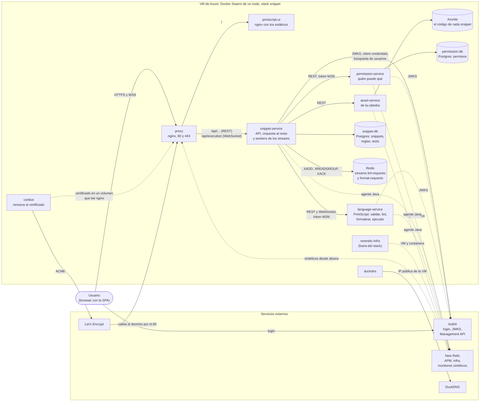
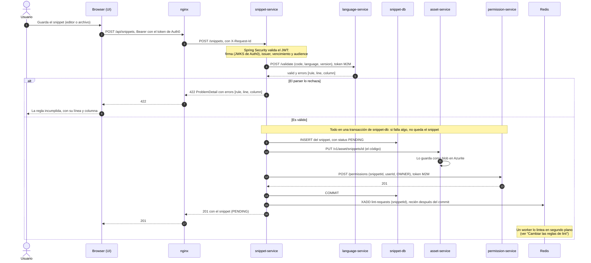
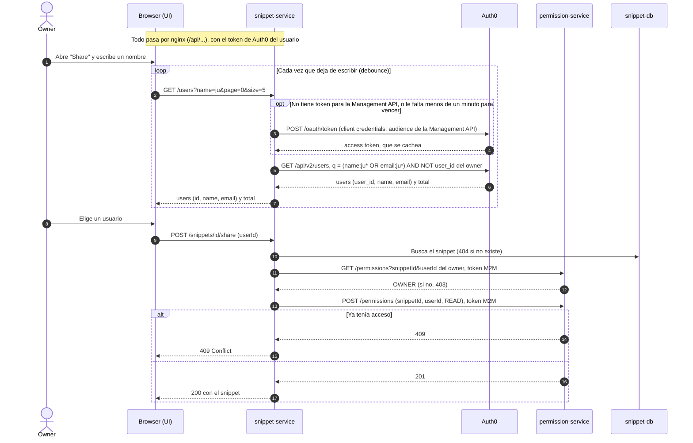
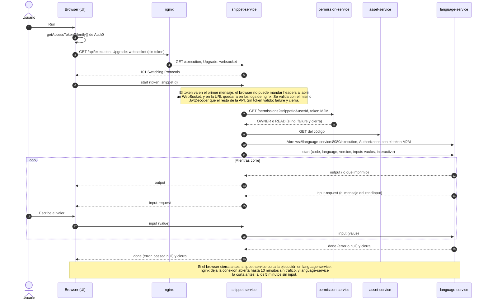
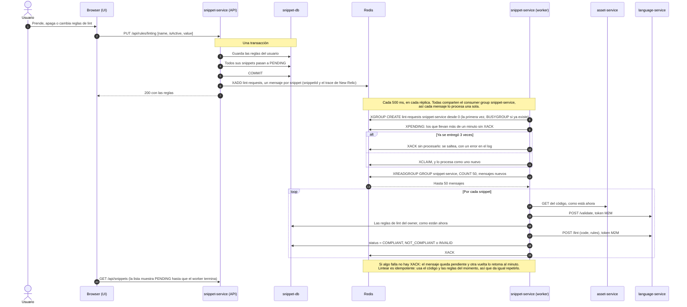
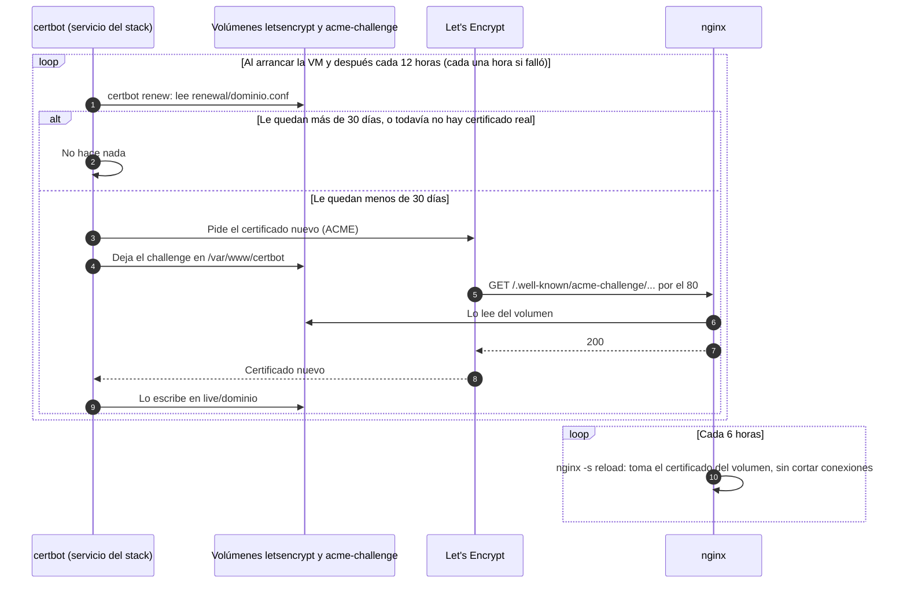

# Arquitectura

Cómo se arma **Snippet Searcher** y qué pasa en sus flujos principales. Está sacado del código de cada repo (`snippet-service`, `permission-service`, `language-service`, `printscript-ui`) y de este; si algo cambia allá, hay que actualizarlo acá.

Las flechas que dicen **token M2M** llevan el access token machine-to-machine con el que `snippet-service` se presenta ante `permission-service` y `language-service` (client credentials de Auth0, audience `https://snippet-searcher/internal`). En el compose local esos dos servicios pueden correr sin pedirlo (`INTERNAL_AUTH_ENABLED=false`).

## Componentes

- **nginx** es la única puerta de entrada (ver [Reverse proxy](../README.md#reverse-proxy-nginx)). A cada pedido le pone un `X-Request-Id` que sigue hasta el servicio.
- **snippet-service** es el único servicio que ve el browser: valida el JWT del usuario (Auth0, audience `https://snippet-searcher/api`) y llama al resto. `permission-service` y `language-service` no saben de usuarios ni se publican.
- El código de cada snippet vive en **Azurite**, detrás de `asset-service`; en `snippet-db` queda su metadata, las reglas de cada usuario y los tests.
- Lo que tarda (lintear y formatear muchos snippets) va por los **streams de Redis** y lo procesan workers dentro de `snippet-service`.

## Crear un snippet (US1, US3)

Solo se guarda un snippet que su parser acepta. Si no, el usuario ve qué regla incumplió y en qué línea y columna.

## Compartir un snippet (US7)

El owner busca al usuario por nombre o email en un listado que se filtra mientras escribe, y el elegido queda con permiso de lectura.

Si Auth0 no responde o falta la aplicación machine-to-machine, la búsqueda da `503` y el resto de la API sigue andando.

## Ejecución interactiva (US10)

Es un WebSocket entre el browser y `snippet-service`, que abre otro con `language-service` y le pasa los mensajes en los dos sentidos. Correr uno de los tests del snippet (US9) es el mismo flujo, con el `testId` en el `start` y los inputs del test.

## Cambiar las reglas de lint: re-linteo asincrónico (US15)

Quien cambia las reglas no espera a que se linteen todos sus snippets: quedan `PENDING` y se lintean de a uno en segundo plano. Cambiar las reglas de formato (US12) funciona igual, con el stream `format-requests`: el worker formatea el snippet, guarda el código y, si cambió, lo encola en `lint-requests`.

## Renovación del certificado HTTPS

El primer certificado lo pide `certbot.sh` en el deploy; los siguientes los renueva el servicio `certbot` del stack, aunque no haya deploys (ver [Despliegue](../README.md#despliegue-en-las-vms-docker-swarm)).

