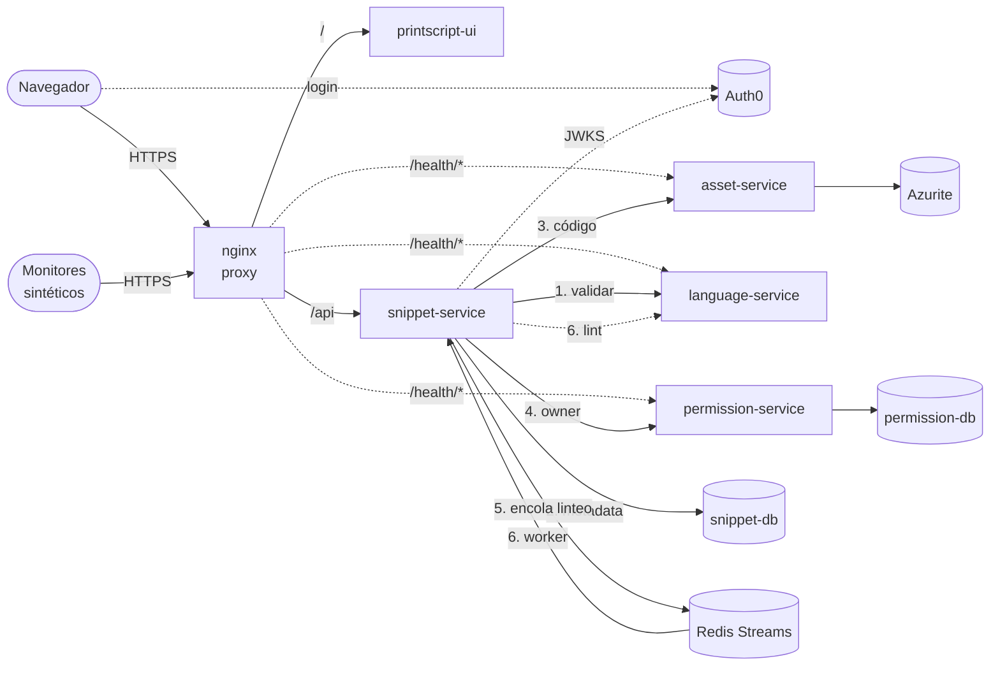

# Observabilidad con New Relic

Lo que pidió la cátedra: métricas que digan algo, monitores sintéticos que fallen, alertas que salten si se cae un servicio (también en medio de un deploy), dashboards que muestren qué está pasando, los puntos de falla de la arquitectura, y el trace de crear un snippet pasando por todos los servicios.

Se mira el sistema desde tres lados:

| Lado | Qué es | Qué ve | Dónde está |
|---|---|---|---|
| **Desde afuera** | Monitores sintéticos de New Relic | Si un usuario puede usarlo: la UI, el health de cada servicio, crear un snippet de punta a punta, el certificado | `synthetics.tf` |
| **Desde cada servicio** | Agente Java de New Relic (APM) en `snippet-service`, `permission-service`, `language-service` y `asset-service` | Pedidos, errores, tiempos, llamados entre servicios, consultas a Postgres y Redis, logs, **traces distribuidos** | `newrelic/newrelic.yml` y el `Dockerfile` de cada servicio; `docker-stack.yml` |
| **Desde la VM** | Agente de infraestructura (`newrelic-infra`, lo levanta `deploy.sh` fuera del stack) | CPU, memoria y disco de la VM; memoria, CPU y recreaciones de cada container | `deploy.sh` |
| **Desde los datos** | Eventos que reporta snippet-service con la API del agente | Cuántos snippets hay (cada minuto), quién crea, comparte y borra, a quién se le muestra vacía la lista teniendo snippets, y cuánto espera en cada stream de Redis | `observability/` y `streams/StreamBacklogReporter.kt` en snippet-service |

Los SLO (`slo.tf`), las alertas (`alerts.tf`) y el dashboard (`dashboard.tf`) se arman con Terraform: los dos entornos quedan iguales y cualquiera del equipo los puede volver a crear.

## SLO y error budget

Un SLI es el % de eventos que anduvieron bien; el SLO, cuánto tiene que dar en los últimos 28 días (la ventana más larga de New Relic); el error budget, cuánto se puede fallar sin romperlo. Están en la página **SLOs** del dashboard, con el budget que queda.

| SLO | Qué cuenta como bien | Objetivo | Por qué |
|---|---|---|---|
| Disponibilidad desde afuera | Los checks de los monitores de la UI y de snippet-service que pasan | 99,5 % (3 h 21 min de budget) | Es lo que ve un usuario, y se mide aunque no haya tráfico. snippet-service da DOWN si se cae su base o Redis. |
| Disponibilidad de la API | Los pedidos a snippet-service que no terminan en 5xx o excepción (sin los health checks) | 99,5 % | Los 4xx no cuentan: un snippet inválido es una respuesta correcta. |
| Lecturas rápidas | Los GET a snippet-service que responden en menos de 500 ms | 99 % | 500 ms y no 300: listar lee el código de cada snippet de la página en asset-service, uno por uno. |

Los dos de la API se crean en el primer `apply` después de que snippet-service reporte a New Relic, porque necesitan su entidad de APM.

Cada SLO tiene su alerta de **fast burn**: salta si en la última hora se gastó más del 2% del budget de los 28 días, que a ese ritmo se termina en unos dos días. Así se avisa cuando el SLO está en riesgo, y no por cada cosa que se ve rara.

Ninguno de los tres hubiera visto los snippets «desaparecidos»: todo respondía 200, y rápido. Para eso están las alertas de los datos.

## La arquitectura y por dónde pasa crear un snippet



`POST /api/snippets` (desde el editor o subiendo un archivo):

1. nginx le pasa el pedido a **snippet-service**, que valida el token de Auth0.
2. **language-service** `/validate`: si el parser no lo acepta, 422 y no se guarda nada.
3. **snippet-db**: guarda la metadata (dentro de una transacción).
4. **asset-service** `PUT /v1/asset/snippets/{id}` → **Azurite**: guarda el código.
5. **permission-service** `POST /permissions` → **permission-db**: registra al owner. Si falla, la transacción se deshace.
6. Después del commit, encola el snippet en el stream `lint-requests` de **Redis**. El worker de snippet-service lo toma, lee el código de asset-service, lo valida y lo lintea en **language-service** con las reglas del owner, y guarda el estado.

### Ver el trace

El agente agrega los headers `traceparent` y `newrelic` a cada llamado HTTP entre servicios, así que los pasos 1 a 5 quedan en un mismo trace. El paso 6 es asíncrono: `RedisStreams.kt` guarda esos headers en el mensaje del stream y el worker los retoma, así el linteo en segundo plano aparece **en el mismo trace** como una transacción `RedisStream/lint-requests`.

1. Crear un snippet desde la UI (o esperar una corrida del monitor `snippet flow`, que crea uno, lo lee y lo borra).
2. En New Relic: **APM & Services → snippet-service-dev → Distributed tracing**, filtrar por `request.uri = '/snippets'` y abrir el trace de un `POST`.
3. Se ve el árbol: snippet-service → language-service (`/validate`) → Postgres (`INSERT`) → asset-service (→ Azurite) → permission-service (→ Postgres), y más abajo `RedisStream/lint-requests` → asset-service (`GET`) → language-service (`/validate`, `/lint`) → Postgres (`UPDATE`).

El dashboard tiene una página **Crear un snippet** con los últimos `trace.id`, el tiempo de cada paso y qué servicios tocó cada creación.

## Puntos de falla

Lo que se puede romper, qué pasa entonces y cómo nos enteramos. *Pendiente* es lo que hoy no está resuelto.

| # | Qué falla | Qué pasa | Cómo nos enteramos | Pendiente |
|---|---|---|---|---|
| 1 | **La VM** (es una sola, un solo nodo de Swarm) | Se cae todo junto. Pasa también si Azure la desasigna (auto-shutdown, la suscripción vence). | `VM sin reportar`, todos los monitores en rojo | Una sola VM por entorno: no hay a dónde mover nada. |
| 2 | **nginx** | Es la única entrada: sin él no hay UI ni API, aunque todo lo demás ande. | Monitores de UI y de health | — |
| 3 | **DuckDNS / el certificado** | Si el dominio deja de apuntar a la VM o vence el certificado, los usuarios no entran. El certificado solo se renueva cuando corre `deploy.sh`. | Monitor `certificate` (15 días antes), monitores de health | Renovar el certificado con un cron, no solo en cada deploy. |
| 4 | **Auth0** | Sin Auth0 no hay login ni se pueden validar tokens: la API responde 401 a todo. | Monitor `snippet flow` (falla en el paso del token) | Es externo: solo se puede detectar. |
| 5 | **snippet-service** | Es el orquestador y tiene una réplica: si se cae, no anda ninguna operación. | Health `snippet-service`, `Servicio sin reportar`, `Container reiniciándose` | — |
| 6 | **Un servicio lento o colgado** | Los `RestClient` de snippet-service no tienen timeout: si language-, permission- o asset-service se cuelgan, cada pedido espera para siempre, ocupando un thread de Tomcat y, dentro de `create`/`update`, una conexión de la base (Hikari tiene 10). Un servicio colgado termina tirando a snippet-service. | `Respuestas lentas`; en el trace se ve qué llamado se lleva el tiempo | Ponerles connect/read timeout a los clientes. |
| 7 | **language-service** | Sin él no se puede crear, editar, lintear, formatear ni correr nada. Además ejecuta código de usuarios. | Health `language-service`, `Servicio sin reportar`, `Linteo... fallando` | — |
| 8 | **permission-service / permission-db** | Sin él nadie ve ningún snippet (la lista falla con 502), ni se puede crear o compartir. | Health `permission-service` (da DOWN si se cae su base), `Servicio sin reportar` | — |
| 9 | **asset-service / Azurite** | Sin ellos no se lee ni se guarda ningún código. Azurite es un emulador: no es almacenamiento durable y no tiene backup. La imagen de la cátedra es `:latest`, puede cambiar sola en un redeploy. Logueaba el cuerpo de cada pedido (el código entero): ahora `AZURE_HTTP_LOG_LEVEL=BASIC`. | Health `asset-service`, monitor `snippet flow` (Azurite no tiene health propio) | Fijar la versión de la imagen; backup del volumen. |
| 10 | **snippet-db** | Sin metadata no anda nada. Volumen local, sin backups. | Health `snippet-service` (da DOWN si se cae su base), `Disco de la VM alta` | Backups (`pg_dump` programado). |
| 11 | **Redis** | No se pierde nada guardado, pero los snippets nuevos quedan en `PENDING` hasta que vuelva: no se lintean ni se formatean. | Health `snippet-service` (da DOWN si se cae Redis), `Linteo... fallando` | — |
| 12 | **Un snippet enorme** (por ejemplo, 3 GB) | nginx corta todo lo que pase de 1 MB con un 413 antes de que llegue a snippet-service. Pero snippet-service no tiene límite propio para el JSON, y el código vive entero en memoria varias veces (el `String`, el JSON a language-service, los bytes a asset-service, la respuesta): si alguien sube el límite de nginx o llega sin pasar por él, el container pasa su límite de 1 GB, Docker lo mata (OOM) y Swarm levanta otro. | `Container cerca del límite de memoria`, `Container reiniciándose`, `Servicio sin reportar`, health `snippet-service` | Limitar el tamaño también en snippet-service (`spring.servlet.multipart.max-file-size` y un límite para el body). |
| 13 | **Un deploy que no levanta** | Con `order: start-first` y `failure_action: rollback`, el container viejo sigue atendiendo hasta que el nuevo está arriba; si el nuevo no arranca, Swarm vuelve a la imagen anterior. Para el usuario no se cae nada, y justamente por eso nadie se enteraría. | `Container reiniciándose` (más de 2 containers en 10 minutos) | — |
| 14 | **Memoria de la VM** | 4 JVMs con límite de 1 GB, 2 Postgres, Redis, Azurite. En un deploy con `start-first` corren 2 JVMs del mismo servicio a la vez. | `Memoria de la VM alta` | — |
| 15 | **Cambio de versión del parser** | `ParserVersionWatcher` revalida todos los snippets de golpe: un pico de carga en language-service. | Dashboard (pedidos por minuto, linteos por minuto) | — |
| 16 | **Ejecutar un snippet** (WebSocket) | El agente no instrumenta WebSockets: las ejecuciones no aparecen como transacciones ni en los traces. | Solo los logs | Instrumentarlo a mano con la API del agente, si hace falta. |

## Alertas

Todas están en la política `snippet-searcher-<entorno>` y llegan por mail a `alert_emails` cuando se abren, se reconocen y se cierran. Un incidente por condición y por servicio: si se caen dos servicios, son dos avisos.

| Condición | Salta cuando | Para qué |
|---|---|---|
| Monitor sintético fallando | Un monitor falla 2 minutos seguidos | Lo que ve el usuario |
| Servicio sin reportar | Un servicio no manda métricas de la JVM por 3 minutos (pérdida de señal) | El proceso no está: caída, OOM, deploy que lo bajó |
| Tasa de errores alta | Más del 5% de los pedidos con error por 5 minutos (warning: 1%) | Un servicio de abajo falla |
| Respuestas lentas | p95 de más de 3 s por 5 minutos | Un servicio colgado o lento (punto 6) |
| Linteo o formateo en segundo plano fallando | Más de 5 mensajes de Redis fallados en 5 minutos | Snippets que quedan en PENDING |
| VM sin reportar | La VM no manda métricas por 5 minutos | La VM apagada o colgada |
| Container cerca del límite de memoria | Más del 90% de su límite por 2 minutos (warning: 80% por 5) | Un OOM por venir (punto 12) |
| Container reiniciándose | Más de 2 containers de un servicio en 10 minutos | Crash loop o deploy con rollback (punto 13) |
| CPU, Memoria, Disco de la VM alta | Más de 90% (disco: 85%) por 5 minutos | Recursos de la VM |
| SLO en riesgo: (uno por SLO) | En la última hora se gastó más del 2% del error budget de 28 días | Se está por romper un SLO |
| Snippets que desaparecieron | En 10 minutos faltan 3 o más snippets en la base que nadie borró (los de antes, más los creados, menos los borrados, contra los de ahora) | La base perdió datos: se recreó, no estaba su volumen (punto 10) |
| Snippets que un usuario no puede ver | Un usuario con snippets en la base lista y permission-service no le devuelve ninguno | Se perdieron los permisos (punto 8) o cambió el `sub` de su token |
| Cola de Redis atrasada | Más de 100 mensajes esperando en un stream por 15 minutos | Saturación del segundo plano: los workers no dan abasto o fallan (punto 11) |

## Puesta en marcha

Una sola vez por cuenta y por entorno.

1. **Cuenta de New Relic.** Con la cuenta gratuita alcanza. De **API keys** se necesitan dos: la **License key** (ingest, la que usan los agentes) y una **User key** (`NRAK-...`, la que usa Terraform). También el **account id**.
2. **La VM.** Agregar `NEW_RELIC_LICENSE_KEY=...` a `~/snippet-searcher/.env` y desplegar el stack (`sh ~/snippet-searcher/deploy.sh`). Los servicios necesitan las imágenes nuevas, que traen el agente: las publica el CD de cada servicio cuando se mergea su PR.
3. **Auth0, para el monitor de punta a punta** (opcional: sin esto se crean todos los demás). En Auth0 → Applications, crear una aplicación *Machine to Machine* autorizada para la API `https://snippet-searcher/api`. El monitor crea sus snippets con ese usuario (`<client id>@clients`) y los borra al terminar.
4. **Terraform** (o OpenTofu), desde esta carpeta:

   ```sh
   cp example.tfvars dev.tfvars                      # y completarlo
   export NEW_RELIC_API_KEY=NRAK-...                 # la User key
   export TF_VAR_auth0_synthetics_client_secret=...  # si se completó auth0_synthetics_client_id
   terraform init
   terraform apply -var-file=dev.tfvars
   ```

   Al final imprime la URL del dashboard. El estado (`terraform.tfstate`) queda en la máquina de quien lo aplicó y guarda el client secret: no se commitea.

Los monitores de ping son gratis y corren cada minuto. El de punta a punta cuenta contra los checks del plan (500 por mes en el gratuito), por eso corre cada 6 horas; para la demo, `flow_check_period = "EVERY_5_MINUTES"` y otro `apply`.

## Probar que las alertas saltan

En la VM de dev, con el dashboard abierto. Cada prueba debería abrir el incidente que dice y mandar el mail; al volver todo a la normalidad, el incidente se cierra solo.

**Bajar un servicio** (lo que pasa si un deploy lo deja abajo):

```sh
docker service scale snippet_permission-service=0
# en 2-3 minutos: "Monitor sintético fallando" (permission-service health) y "Servicio sin reportar" (permission-service-dev)
docker service scale snippet_permission-service=1
```

**Un deploy con una imagen que no arranca** (Swarm hace rollback y el usuario no ve nada):

```sh
docker service update --image ghcr.io/ingsis-2026/language-service:no-existe snippet_language-service
# Swarm no puede bajar la imagen y vuelve a la anterior; un servicio que arranca y se cae en loop dispara "Container reiniciándose"
```

**Un snippet enorme.** Por la API pública, nginx lo corta antes de mirar el token:

```sh
head -c 3000000000 /dev/zero | tr '\0' 'a' > /tmp/huge.ps
curl -s -o /dev/null -w '%{http_code}\n' \
  -F name=huge -F description=huge -F language=printscript -F version=1.1 -F file=@/tmp/huge.ps \
  https://snippetsearcher-ingsis2026-dev.duckdns.org/api/snippets
# 413: nginx no lo deja pasar (client_max_body_size 1m) y snippet-service ni se entera.
```

Para ver qué pasaría sin ese límite (punto 12), se puede achicar el límite de memoria del container hasta que la JVM no entre, y ver cómo saltan `Container cerca del límite de memoria`, `Container reiniciándose` y `Servicio sin reportar`. Si el container nuevo no llega a arrancar, Swarm vuelve solo al límite anterior (rollback), que también dispara `Container reiniciándose`:

```sh
docker service update --limit-memory 300M snippet_snippet-service
# usar la app un rato (crear, listar, formatear); después, si no volvió solo, el límite del stack:
docker service update --limit-memory 1G snippet_snippet-service
```

**La VM apagada:** detenerla desde Azure. Saltan `VM sin reportar` y todos los monitores.

**Snippets que desaparecen** (el caso de las 3 AM). Borrarlos directo de la base, sin pasar por la API, es lo mismo que una base que perdió datos:

```sh
cd ~/snippet-searcher && set -a && . ./.env && set +a
# crear antes al menos 3 snippets de prueba sin tests desde la UI; después:
docker exec $(docker ps -q -f name=snippet_snippet-db) psql -U "$SNIPPET_DB_USER" -d "$SNIPPET_DB_NAME" \
  -c "DELETE FROM snippet WHERE id IN (SELECT id FROM snippet WHERE id NOT IN (SELECT snippet_id FROM test_case) LIMIT 3)"
# en unos 10 minutos: "Snippets que desaparecieron". Solo en dev, con snippets de prueba: no se recuperan.
```

**Una cola atrasada:** con language-service abajo, los linteos se acumulan en Redis.

```sh
docker service scale snippet_language-service=0
# crear o editar más de 100 snippets (o cambiar las reglas de lint de un usuario con muchos); en 15 minutos,
# "Cola de Redis atrasada". Después:
docker service scale snippet_language-service=1
```
